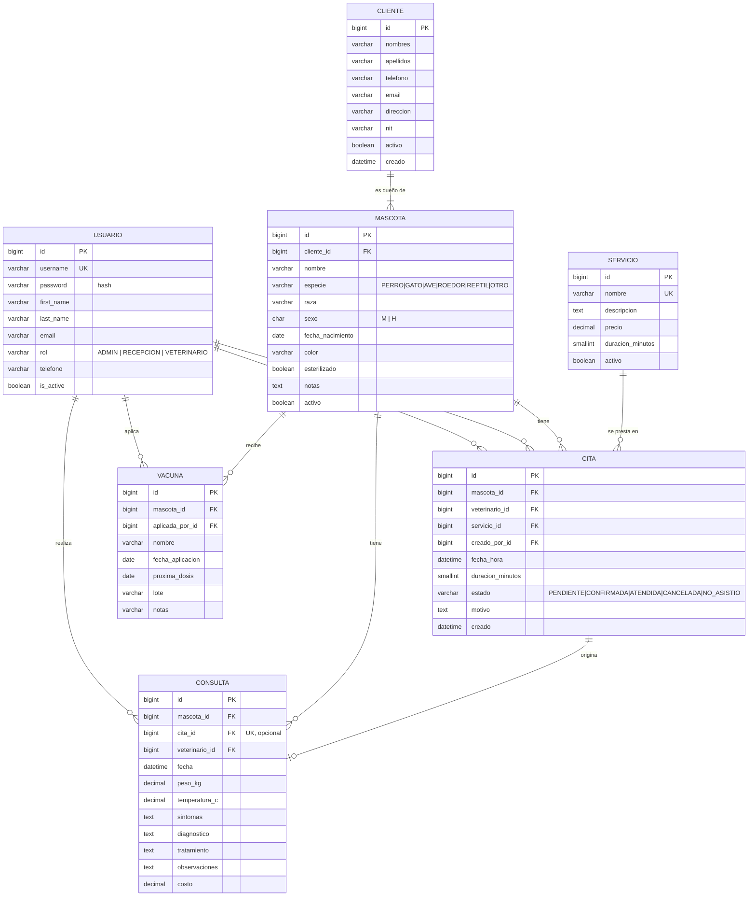

# 3. Diagrama Entidad-Relación

> GitHub dibuja este diagrama automáticamente. Para obtener una **imagen PNG/SVG** para el documento o la
> presentación, abre [`diagrama_er.html`](diagrama_er.html) en el navegador y haz una captura, o pega el código
> en <https://mermaid.live> y descarga la imagen.

## Relaciones y reglas de integridad

| Relación | Cardinalidad | `on_delete` | Por qué |
|---|---|---|---|
| Cliente → Mascota | 1 : N (un cliente tiene 1 o más mascotas) | `PROTECT` | No se borra un dueño con mascotas registradas. |
| Mascota → Cita / Consulta / Vacuna | 1 : N | `PROTECT` | El historial clínico no se pierde al borrar por error. |
| Usuario (veterinario) → Cita / Consulta | 1 : N | `PROTECT` | Se conserva quién atendió. Los usuarios se **desactivan**, no se borran. |
| Servicio → Cita | 1 : N | `PROTECT` | No se borra un servicio que ya se usó. |
| Cita → Consulta | 1 : 0..1 | `SET_NULL` | Una cita se atiende una sola vez; una consulta puede existir sin cita (urgencia). |
| Usuario → Cita (`creado_por`), Vacuna (`aplicada_por`) | 1 : N | `SET_NULL` | Trazabilidad opcional. |

## Diccionario de datos (resumen)

**usuario** — extiende `AbstractUser` de Django. `rol` define los permisos. Se desactiva con `is_active=False`.

**cliente** — propietario. `telefono` valida 8 dígitos (`2222-3333`). Índice por `(apellidos, nombres)` para búsquedas.

**mascota** — paciente. `edad` se calcula (no se guarda) a partir de `fecha_nacimiento`.

**servicio** — catálogo. `duracion_minutos` determina cuántos "espacios" ocupa una cita en la agenda.

**cita** — `duracion_minutos` se copia del servicio al guardar, para que cambiar el servicio después no mueva
citas ya agendadas. Índices por `fecha_hora` y `(veterinario, fecha_hora)` aceleran el cálculo de horarios libres.

**consulta** — registro clínico; `costo` toma por defecto el precio del servicio de la cita.

**vacuna** — `proxima_dosis` permite listar refuerzos vencidos o próximos (índice propio).

## Normalización

El modelo está en **3FN**: no hay atributos repetidos (los datos del dueño viven en `cliente`, no en `mascota`),
cada atributo depende de la clave de su tabla y los valores calculados (edad, fin de cita, nombre completo) no se almacenan.
La única copia deliberada es `cita.duracion_minutos` (desnormalización controlada, explicada arriba).
